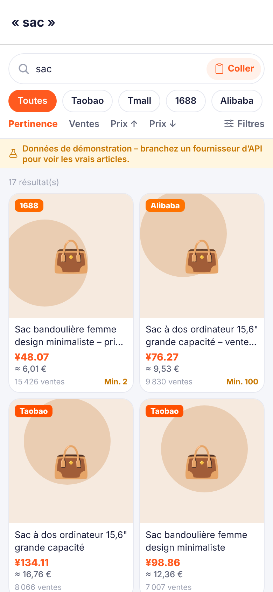
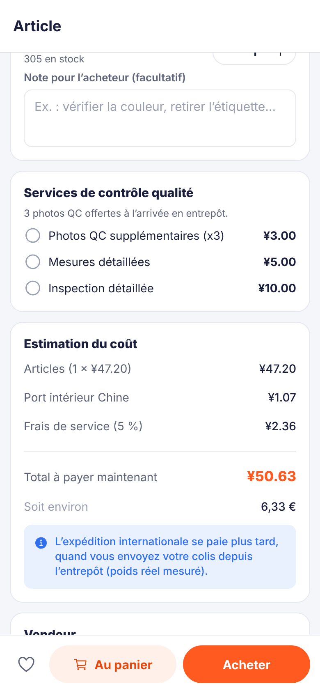
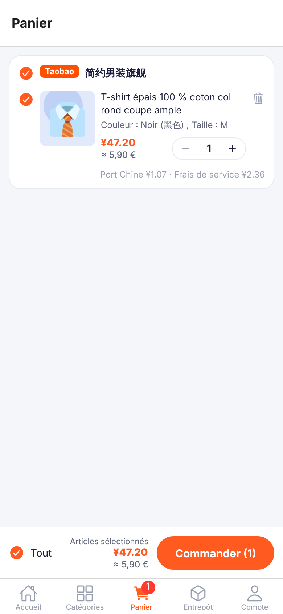
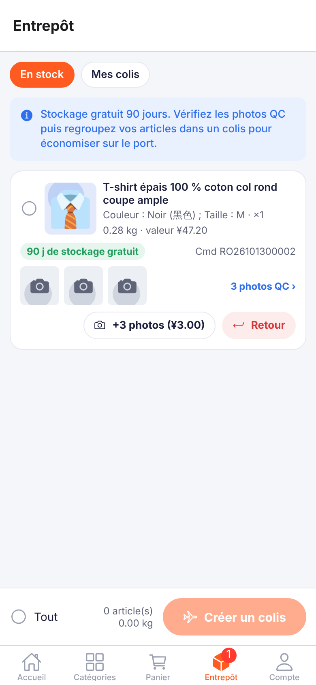
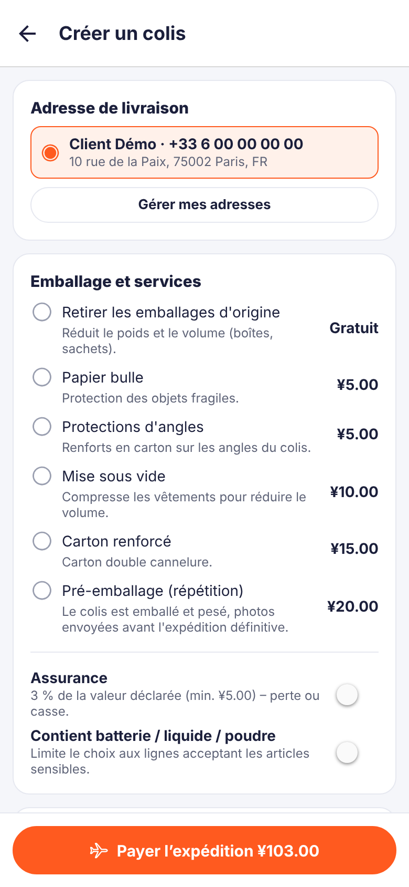
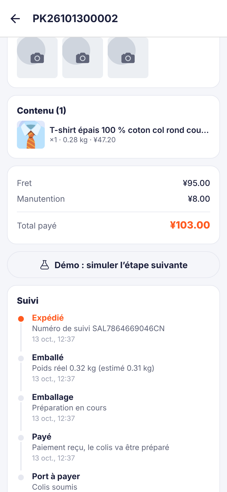
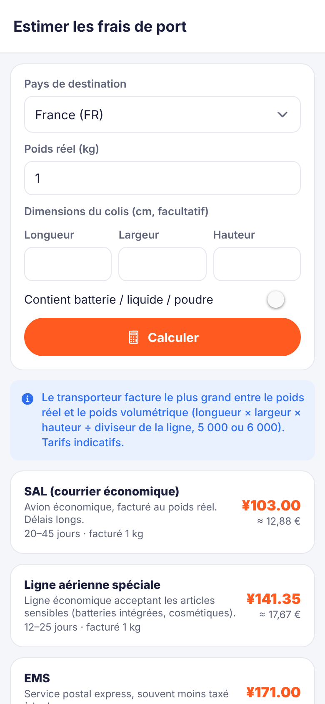
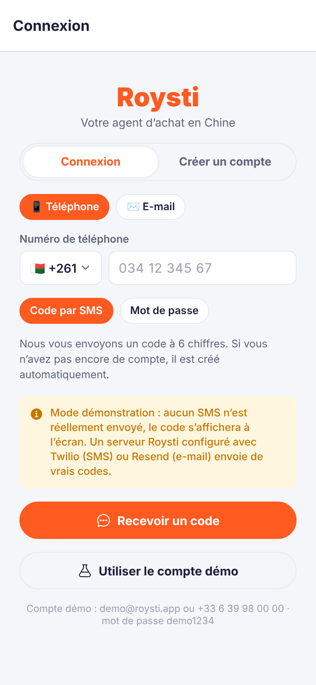
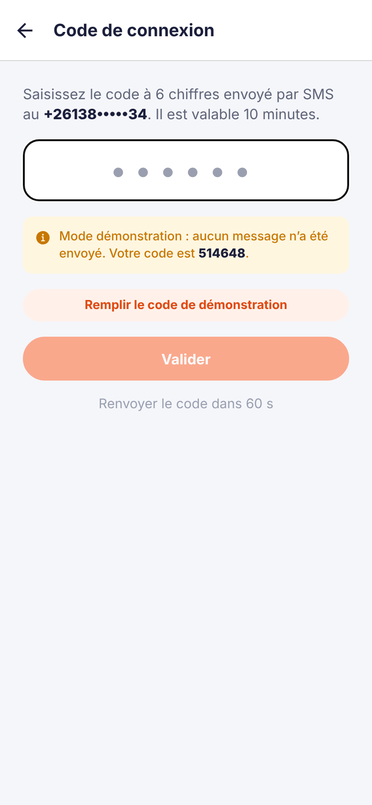
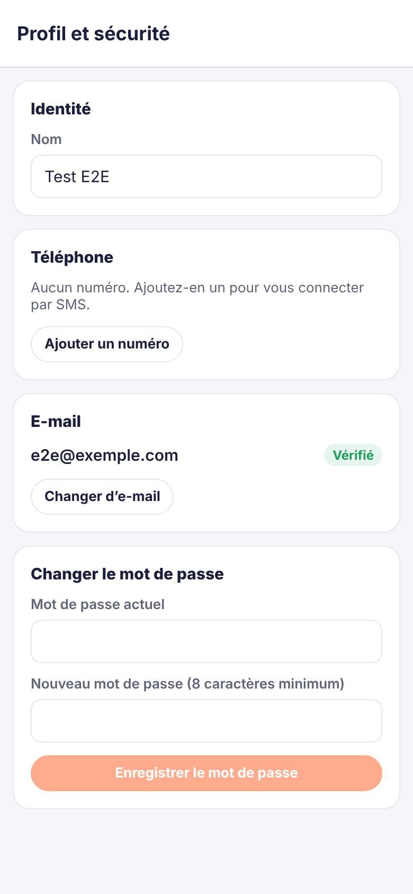

# Roysti – agent d'achat mobile pour Taobao, 1688, Alibaba…

Application mobile inspirée de **Superbuy** et **CSSBuy** : on y cherche ou colle un lien d'article chinois (Taobao, Tmall, 1688, Alibaba, JD, Weidian), on voit le prix, les options et les caractéristiques, on commande, on contrôle les photos en entrepôt, puis on regroupe ses achats dans un colis expédié à l'international.

- **Analyse des fonctionnalités** de Superbuy et CSSBuy, des moyens techniques et des formules : [`docs/ANALYSE.md`](docs/ANALYSE.md) (version Word avec équations : [`docs/Analyse-Superbuy-CSSBuy.docx`](docs/Analyse-Superbuy-CSSBuy.docx))
- **Application mobile** : [`mobile/`](mobile) – Expo SDK 57, React Native, Expo Router (iOS, Android, web)
- **API** : [`backend/`](backend) – Node.js, Express 5, TypeScript

| Accueil | Recherche | Fiche article | Panier |
|---|---|---|---|
|  |  |  |  |
| **Entrepôt (photos QC)** | **Création de colis** | **Suivi du colis** | **Estimateur de port** |
|  |  |  |  |
| **Connexion (téléphone ou e-mail)** | **Code à 6 chiffres** | **Profil et sécurité** | |
|  |  |  | |

> ⚠️ Par défaut, l'application tourne sur un **catalogue de démonstration** (produits, prix et vendeurs fictifs), signalé par un bandeau jaune. Pour afficher les **vrais articles**, collez une clé de fournisseur d'API dans **Compte → Réglages → Articles réels (API)** (voir [Données réelles](#données-réelles)). Roysti ne peut pas fournir de clé : chaque fournisseur demande une inscription à votre nom.

## Tester l'APK Android

**Téléchargement direct (sans compte GitHub) : <https://github.com/roysti/Roysti/releases/latest/download/Roysti.apk>** – toutes les versions : <https://github.com/roysti/Roysti/releases>

1. Ouvrez le lien sur le téléphone Android et téléchargez `Roysti.apk`.
2. Ouvrez le fichier ; si Android le demande, autorisez « Installer des applications inconnues » pour votre navigateur.
3. Lancez Roysti, puis **Compte → Se connecter → « Utiliser le compte démo »**.

L'APK fonctionne **seul, sans serveur** : la logique du backend est embarquée dans l'application (mode « intégré »), avec le catalogue de démonstration et vos données (compte, commandes, colis) enregistrées sur le téléphone. **Compte → Réglages** permet de basculer vers un serveur Roysti distant ou de réinitialiser les données.

L'APK est compilé automatiquement par GitHub Actions ([`.github/workflows/android-apk.yml`](.github/workflows/android-apk.yml)) à chaque modification de `mobile/` ou `backend/src/`. C'est un build de test signé avec la clé de debug d'Expo, pour téléphones ARM (arm64-v8a, armeabi-v7a), Android 7.0 ou plus récent ; une publication sur le Play Store demandera une clé de signature dédiée.

## Fonctionnalités

**Trouver un article**
- Recherche multi-plateformes en français ou en chinois, filtres (plateforme, catégorie, prix) et tri (pertinence, ventes, prix).
- Collage de lien : Taobao, Tmall, 1688, Alibaba, JD, Weidian, liens courts `m.tb.cn`, textes de partage « 【淘宝】… », liens CSSBuy et Superbuy.
- Fiche article : galerie, prix en CNY et converti dans votre devise, titre traduit et titre chinois d'origine, options (couleur, taille…) avec stock par SKU, **prix de gros par paliers** et quantité minimale (1688, Alibaba), vendeur, caractéristiques, lien vers l'annonce d'origine.

**Acheter**
- Panier groupé par vendeur, note pour l'acheteur, services QC (photos supplémentaires, mesures, inspection).
- Une commande par vendeur ; paiement par le solde du portefeuille ; codes promo.
- Suivi des commandes : à payer → payée → achetée → expédiée vers l'entrepôt → en entrepôt.

**Entrepôt et expédition**
- Photos de contrôle qualité, poids mesuré, jours de stockage gratuit restants, retour au vendeur sous 7 jours.
- Création de colis : adresse, services d'emballage (retrait des boîtes, mise sous vide, papier bulle, carton renforcé, pré-emballage), assurance, articles sensibles, comparaison des lignes (DHL, FedEx, EMS, ligne spéciale, SAL, maritime).
- Calcul du poids volumétrique et du poids facturé, régularisation automatique après la pesée réelle, numéro de suivi.
- Transfert de colis achetés par vous-même (avec code client), estimateur de frais de port.

**Compte** : portefeuille et recharges, adresses, coupons, favoris, notifications, devise d'affichage (EUR, USD, MGA, XOF, CAD…).

**Connexion par e-mail ou par numéro de téléphone**
- Connexion **par code à 6 chiffres** (SMS ou e-mail ; le compte est créé au premier code) ou **par mot de passe**, avec l'e-mail ou le numéro au choix.
- Numéros saisis au format national avec l'indicatif du pays (Madagascar par défaut), normalisés au format international E.164 (`libphonenumber-js`).
- Vérification de l'e-mail et du numéro, ajout ou changement de l'un ou de l'autre, mot de passe oublié (code puis nouveau mot de passe, autres appareils déconnectés).
- Codes à usage unique hachés, valables 10 minutes, 5 essais au plus, renvoi après 60 s et 5 envois par heure et par destinataire ; réponses identiques que le compte existe ou non.
- Envoi réel par **Twilio** (SMS) et **Resend** (e-mail) quand le serveur est configuré ; sinon, mode démonstration : le code s'affiche à l'écran.

## Démarrage rapide (développement)

Prérequis : Node.js 20 ou plus récent.

```bash
# 1. API (port 4000)
cd backend
npm install
npm run dev

# 2. Application mobile (dans un autre terminal)
cd mobile
npm install
npx expo start          # puis scanner le QR code avec Expo Go, ou touche « w » pour le web
```

Compte de démonstration : **demo@roysti.app / demo1234** (bouton « Utiliser le compte démo » sur l'écran de connexion).

Par défaut, l'application utilise l'**API intégrée** : elle fonctionne sans démarrer le backend. Pour utiliser le serveur à la place, choisissez « Serveur Roysti » dans **Compte → Réglages** (l'adresse par défaut est l'IP de l'ordinateur qui fait tourner Expo, port 4000), ou compilez avec `EXPO_PUBLIC_API_URL` (ex. `http://192.168.1.20:4000/api`), ce qui active le mode serveur.

En mode démo, le bouton **« Démo : simuler l'étape suivante »** sur une commande ou un colis joue le rôle de l'équipe d'achat et de l'entrepôt (achat, réception avec photos, emballage, pesée, expédition).

## Configuration de l'API

| Variable | Défaut | Rôle |
|---|---|---|
| `PORT` | `4000` | Port HTTP |
| `PRODUCT_PROVIDER` | `mock` | `mock` (catalogue de démo), `otapi`, `onebound` ou `tmapi` |
| `RAPIDAPI_KEY` | – | Clé RapidAPI pour `otapi` (hôtes : `OTAPI_HOST_TAOBAO`, `OTAPI_HOST_1688` ; langue : `OTAPI_LANGUAGE`, `en` par défaut) |
| `ONEBOUND_KEY`, `ONEBOUND_SECRET` | – | Identifiants Onebound (`ONEBOUND_LANG` : `cn` par défaut, `en`, `ru` ; `ONEBOUND_BASE_URL`) |
| `TMAPI_API_TOKEN` | – | apiToken TMAPI (`TMAPI_BASE_URL` : `https://api.tmapi.io` par défaut ; `TMAPI_LANGUAGE` : `zh` ou `en`) |
| `FEATURED_QUERY` | `热销` | Mots-clés de la page d'accueil avec un vrai fournisseur |
| `SMS_PROVIDER` | – | `twilio` pour envoyer les codes par SMS : `TWILIO_ACCOUNT_SID`, `TWILIO_AUTH_TOKEN`, `TWILIO_FROM` ou `TWILIO_MESSAGING_SERVICE_SID` |
| `EMAIL_PROVIDER` | – | `resend` pour envoyer les codes par e-mail : `RESEND_API_KEY`, `EMAIL_FROM` |
| `DEMO_MODE` | `true` | Active les routes `/api/demo/*` et le compte démo |
| `DATA_FILE` | – | Fichier JSON de persistance (sinon tout est en mémoire) |
| `RATES_URL` | `https://open.er-api.com/v6/latest/CNY` | Service de taux de change |
| `RATES_OFFLINE` | `false` | `true` = taux de secours approximatifs uniquement |
| `WAREHOUSE_RECIPIENT`, `WAREHOUSE_ADDRESS`, `WAREHOUSE_PHONE` | « À configurer » | Adresse de l'entrepôt affichée pour les transferts |

Les frais de service, la durée de stockage, les services à valeur ajoutée, l'assurance et la grille des lignes d'expédition se règlent dans [`backend/src/config.ts`](backend/src/config.ts). **Ce sont des valeurs de démonstration**, pas les tarifs de Superbuy ou de CSSBuy.

## Données réelles

L'API ne dépend que de l'interface `ProductProvider` ([`backend/src/providers/types.ts`](backend/src/providers/types.ts)). Quatre sources sont disponibles :

| Fournisseur | Plateformes | Clé | Coût (indicatif, à vérifier chez le fournisseur) |
|---|---|---|---|
| `mock` | les 6, fictives | aucune | gratuit |
| `otapi` – OTAPI d'OpenTrade Commerce **via RapidAPI** (conseillé hors de Chine) | Taobao, Tmall, 1688 ; titres traduits en anglais + titre chinois | compte [RapidAPI](https://rapidapi.com) (carte bancaire), abonnement aux API [« Taobao Tmall »](https://rapidapi.com/open-trade-commerce-open-trade-commerce-default/api/taobao-tmall1) et/ou [« Otapi 1688 »](https://rapidapi.com/open-trade-commerce-open-trade-commerce-default/api/otapi-1688), clé `X-RapidAPI-Key` | palier gratuit d'environ 20 requêtes/jour puis payant (d'après la page de tarifs d'« Otapi 1688 ») |
| `onebound` – passerelle [Onebound](https://console.open.onebound.cn/console/?lang_code=en) (万邦) | Taobao, Tmall, 1688, JD, Alibaba.com (prix USD convertis en CNY), Weidian | `key` + `secret` | essai de 10 appels/jour ; environ 0,02 CNY par appel selon des sources secondaires ; **chaque appel est facturé, même en échec** |
| `tmapi` – [TMAPI](https://tmapi.top) | 1688 (recherche + fiches) ; Taobao/Tmall par lien uniquement | `apiToken` (console TMAPI, Account Center) | sur devis |

**Dans l'APK (mode intégré)** : **Compte → Réglages → Articles réels (API)**, choisissez le fournisseur, collez la clé, **Tester la connexion** (une seule petite recherche), puis **Enregistrer**. La clé est chiffrée sur le téléphone (`expo-secure-store`, Android Keystore) et n'est envoyée qu'au fournisseur, que l'application appelle directement. Pour une application distribuée à des clients, placez plutôt la clé sur un serveur Roysti (variables ci-dessus) : elle ne quitte alors jamais le serveur.

**Côté serveur** : `PRODUCT_PROVIDER=otapi RAPIDAPI_KEY=… npm start` (ou `onebound`, `tmapi`). `GET /api/provider/test` vérifie la clé.

Ce que fait l'application avec un vrai fournisseur :
- **recherche traduite** : les plateformes cherchent en chinois, donc les termes courants sont traduits (« robe rouge » → « 连衣裙 红色 », « coque iPhone 15 » → « 手机壳 iphone 15 »). Les marques et modèles sont gardés, le chinois est envoyé tel quel, et l'écran affiche les mots-clés envoyés. Les catégories ajoutent leur mot-clé chinois ;
- **cache** de 10 min (recherches) et 30 min (fiches) devant les API payantes : une requête identique ne coûte qu'un appel, et les erreurs ne sont jamais mises en cache ;
- **prix toujours relus chez le fournisseur** à l'ajout au panier et au paiement. Un article sans prix connu (0 ou -1) ne peut pas être commandé, et un article ajouté depuis une autre source (par exemple le catalogue de démo) doit être ajouté à nouveau ;
- **erreurs expliquées** : clé refusée, abonnement manquant, quota épuisé, article introuvable. Les clés n'apparaissent jamais dans les messages.

D'où viennent les formats ? Les sites des fournisseurs n'étaient pas joignables depuis l'environnement de développement. La correspondance des champs a donc été établie à partir de **réponses brutes réelles publiées** :
- Onebound : `taobao/item_get` d'octobre 2026, et `1688/item_get` et `item_search` ;
- OTAPI : fiche Taobao complète, et enveloppe de recherche d'un autre hôte OTAPI de RapidAPI ;
- TMAPI : copies de la documentation 1688 avec exemples JSON.

Les tests reprennent ces structures (`backend/test/providers.test.ts`). Restent **non vérifiés sur une réponse brute** : JD, Alibaba.com et Weidian chez Onebound, les paliers 1688 chez OTAPI, et Taobao chez TMAPI. Le parsing y est défensif. Avec votre clé, enregistrez une première réponse de chaque plateforme pour confirmer.

L'extraction directe des pages des plateformes est déconseillée (conditions d'utilisation, blocages).

## API

| Méthode et route | Rôle |
|---|---|
| `GET /api/meta` | Plateformes, catégories, pays, lignes, services, frais |
| `GET /api/rates` | Taux de change depuis le CNY |
| `GET /api/products/search?q=&platform=&category=&sort=&page=` | Recherche |
| `GET /api/products/featured` | Tendances |
| `GET /api/products/:platform/:itemId` | Fiche article |
| `POST /api/links/parse` | Lien ou texte de partage → plateforme + identifiant |
| `POST /api/shipping/estimate` | Devis toutes lignes |
| `GET /api/provider/test` | Vérifie la clé du fournisseur (un appel) |
| `GET /api/auth/config`, `POST /api/auth/register`, `POST /api/auth/login` | Configuration (canaux démo ou réels), inscription, connexion par mot de passe (e-mail ou numéro) |
| `POST /api/auth/otp/request`, `POST /api/auth/otp/verify`, `POST /api/auth/password/reset` | Code par SMS/e-mail (connexion, vérification, réinitialisation) |
| `GET/PATCH /api/me`, `POST /api/me/verify`, `POST /api/me/password` | Profil, vérification d'un e-mail ou d'un numéro, mot de passe |
| `GET/POST /api/cart`, `PATCH/DELETE /api/cart/:id` | Panier |
| `POST /api/orders/checkout`, `POST /api/orders/pay`, `GET /api/orders`, `POST /api/orders/:id/cancel` | Commandes |
| `GET /api/warehouse`, `POST /api/warehouse/:id/photos`, `POST /api/warehouse/:id/return` | Entrepôt |
| `POST /api/parcels/quote`, `POST /api/parcels`, `POST /api/parcels/:id/pay`, `GET /api/parcels/:id` | Colis |
| `POST /api/forwarding` | Transfert de colis |
| `GET /api/wallet`, `POST /api/wallet/topup` | Portefeuille |
| `/api/addresses`, `/api/coupons`, `/api/favorites`, `/api/notifications` | Compte |
| `POST /api/demo/orders/:id/advance`, `POST /api/demo/parcels/:id/advance` | Simulation entrepôt (mode démo) |

Les prix sont toujours recalculés côté serveur à partir du fournisseur : le prix envoyé par l'application est ignoré.

### Architecture partagée

La table des routes et l'aiguillage vivent dans [`backend/src/core/api.ts`](backend/src/core/api.ts), sans dépendance à Express ni à Node :

- le serveur ([`backend/src/app.ts`](backend/src/app.ts)) n'est qu'un adaptateur HTTP autour de ce cœur ;
- l'application mobile exécute le même cœur directement dans Hermes ([`mobile/src/lib/local-api.ts`](mobile/src/lib/local-api.ts)). Metro l'embarque grâce à [`mobile/metro.config.js`](mobile/metro.config.js) ;
- les services propres à la plateforme sont injectés : crypto (`node:crypto` côté serveur, `expo-crypto` + `@noble/hashes` dans l'app) et persistance (fichier JSON ou AsyncStorage). Un test vérifie que le cœur n'importe aucun module Node.

## Tests et vérifications

```bash
cd backend && npm test && npm run typecheck   # 98 tests : liens, frais, port, parcours complet, cœur portable, connexion, fournisseurs
cd mobile && npx tsc --noEmit && npx expo lint
```

Trois parcours ont aussi été joués dans Chromium sur la version web de l'application, en mode intégré, sans serveur :
- l'achat complet : recherche → fiche → panier → paiement → entrepôt → colis → expédition ;
- la connexion : téléphone et code, inscription par e-mail et vérification, téléphone et mot de passe, mot de passe oublié ;
- les vrais articles : mauvaise clé, bonne clé, accueil, recherche traduite, fiche, panier. Les réponses OTAPI y étaient simulées, car les API ne sont pas joignables depuis l'environnement de développement.

Le bundle Android est compilé en bytecode Hermes à chaque build.

## Avant une mise en production

Clé fournisseur sur le serveur, traduction des titres en français, base PostgreSQL, vrai prestataire de paiement (Stripe, PayPal, Mobile Money) avec webhooks, back-office pour les acheteurs et l'entrepôt, tarifs transporteurs réels, notifications push, builds EAS, conditions générales, RGPD et règles douanières. Le détail est dans [`docs/ANALYSE.md`](docs/ANALYSE.md#7-avant-une-mise-en-production).
